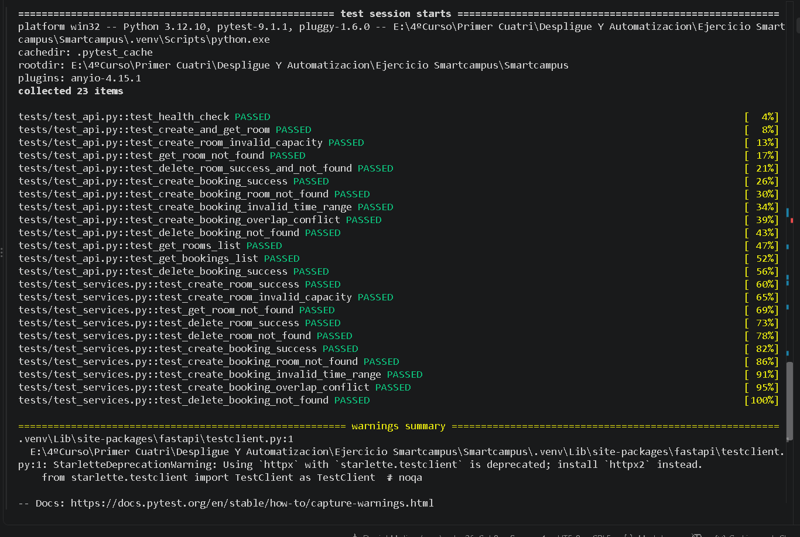
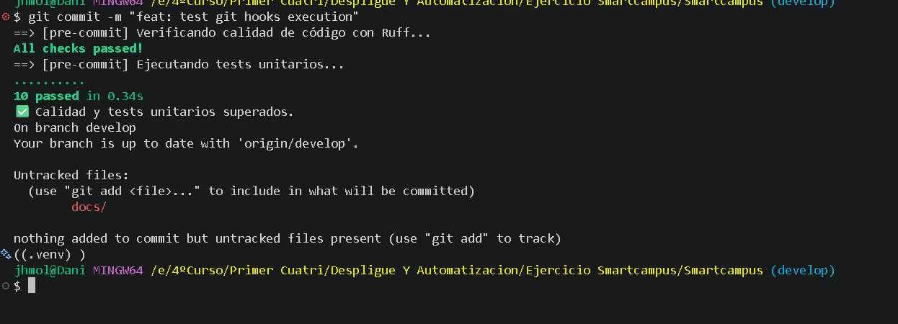
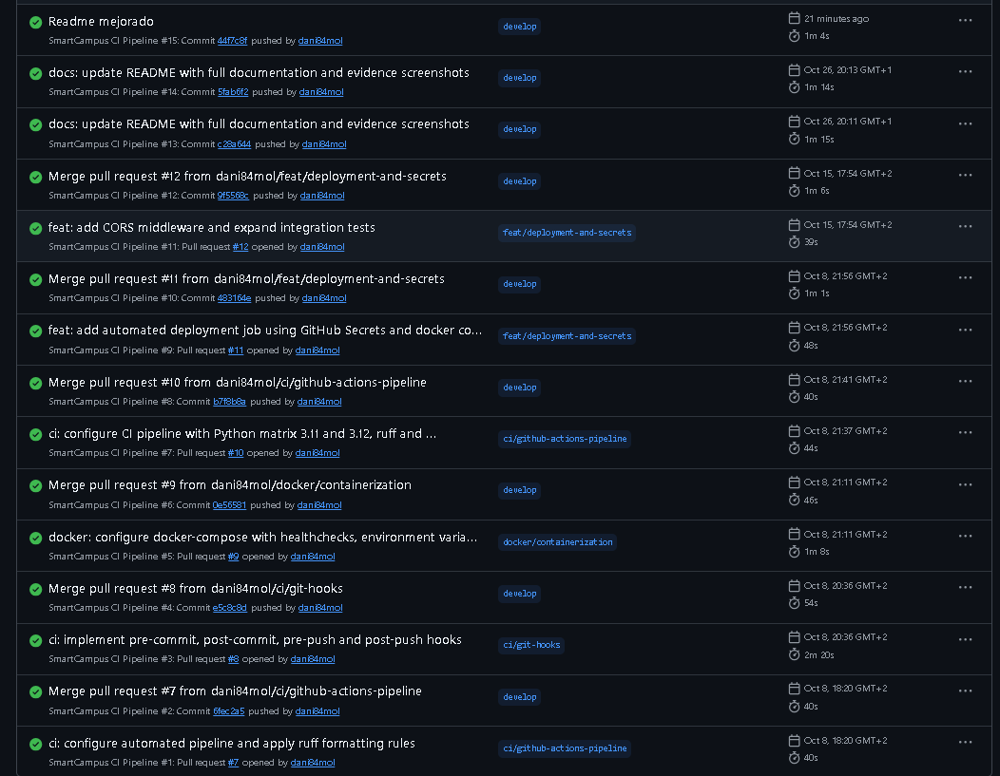
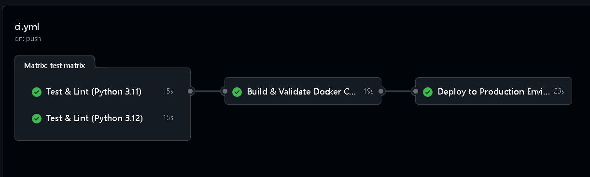
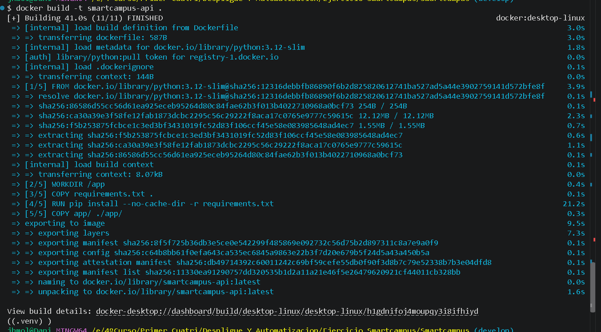
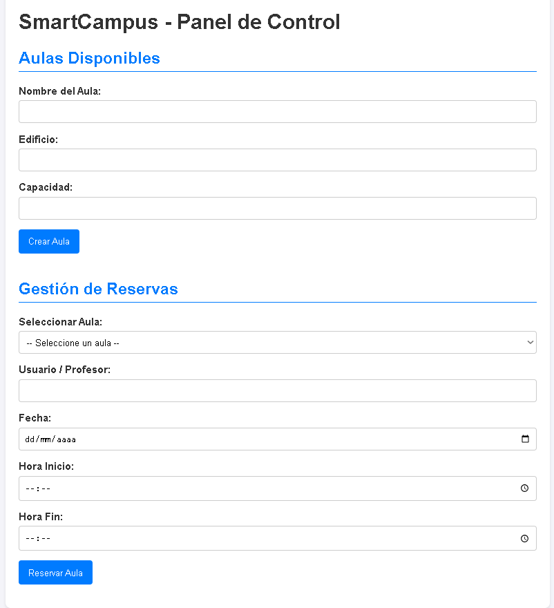
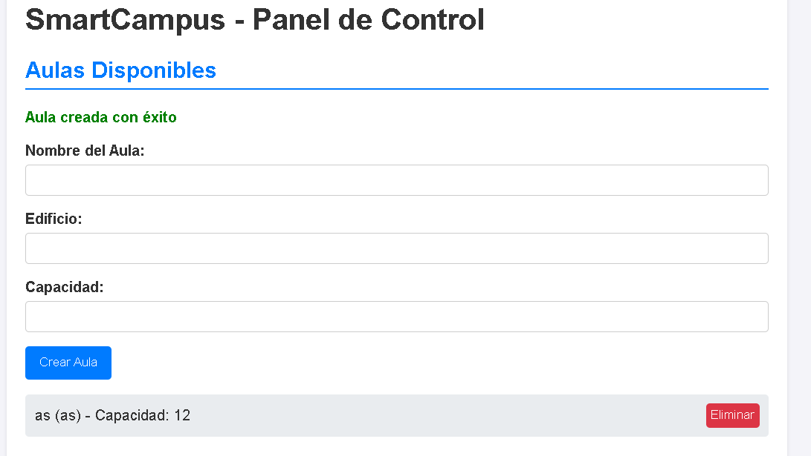
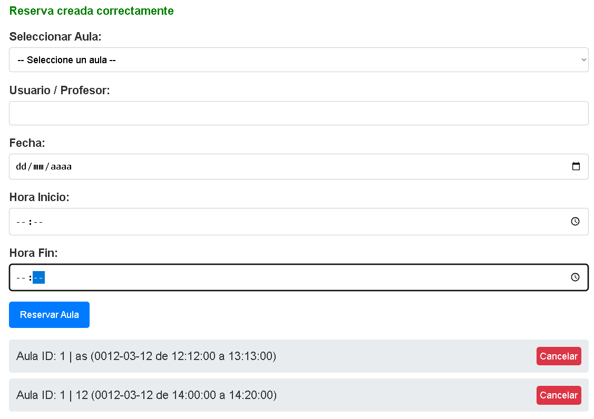
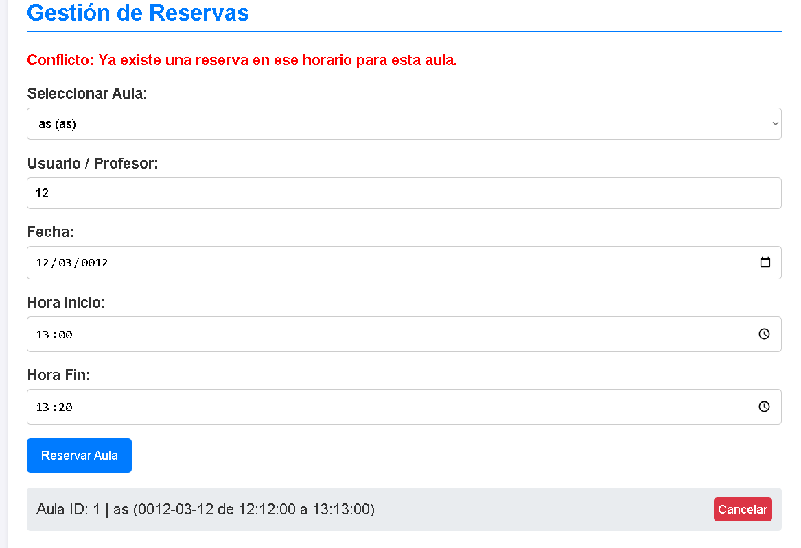

# SmartCampus Solutions — Microservicio REST API

Microservicio REST para la gestión de aulas y reservas universitarias desarrollado con **FastAPI**, **Pydantic** y **Uvicorn**, diseñado para automatizar el control de espacios académicos mediante un flujo completo de CI/CD, validación por Git Hooks, contenerización con Docker y orquestación con Docker Compose.

---

## 📋 Tabla de Contenidos

- [Descripción](#descripción)
- [Arquitectura](#arquitectura)
- [Instalación](#instalación)
- [Ejecución Local](#ejecución-local)
- [Docker](#docker)
- [Docker Compose](#docker-compose)
- [Tests](#tests)
- [Git Hooks](#git-hooks)
- [GitHub Actions](#github-actions)

---

## 📑 Descripción

### ¿Qué problema resuelve la aplicación?
En los entornos universitarios, la gestión manual de aulas y reservas suele generar conflictos de solapamiento de horarios, uso ineficiente de espacios y falta de visibilidad en tiempo real para profesores y administradores. 

**SmartCampus REST API** resuelve este problema ofreciendo:
1. **Gestión centralizada de aulas**: Registro, consulta detallada y eliminación de espacios físicos especificando su capacidad y equipamiento.
2. **Control automatizado de reservas**: Creación y cancelación de reservas verificando disponibilidad en tiempo real.
3. **Validación estricta de reglas de negocio**: Prevención automática de solapamientos horarios en la misma aula y fecha, garantía de coherencia temporal (hora de inicio anterior a fin) y restricción de aforos inválidos ($\le 0$).

---

## 🏗️ Arquitectura

La aplicación sigue una arquitectura en capas **MVC/Clean Architecture** desacoplada, priorizando la simplicidad, el rendimiento asíncrono y la facilidad de pruebas:

┌─────────────────────────────────────────┐
              │           Cliente HTTP / FrontEnd       │
              └────────────────────┬────────────────────┘
                                   │ HTTP / JSON
                                   ▼
┌───────────────────────────────────────────────────────────────────────────┐
│                              SmartCampus API                              │
│                                                                           │
│   ┌───────────────────────────────────────────────────────────────────┐   │
│   │                      Controladores (app/main.py)                  │   │
│   │   - GET /health           - POST /rooms                           │   │
│   │   - GET /rooms            - DELETE /rooms/{id}                    │   │
│   │   - GET /rooms/{id}       - GET/POST/DELETE /bookings             │   │
│   └─────────────────────────────────┬─────────────────────────────────┘   │
│                                     │                                     │
│                                     ▼                                     │
│   ┌───────────────────────────────────────────────────────────────────┐   │
│   │                    Modelos Pydantic (app/models.py)               │   │
│   │   - RoomCreate / Room     - BookingCreate / Booking               │   │
│   └─────────────────────────────────┬─────────────────────────────────┘   │
│                                     │ Validaciones de Esquema             │
│                                     ▼                                     │
│   ┌───────────────────────────────────────────────────────────────────┐   │
│   │                   Capa de Servicio (app/services.py)               │   │
│   │   - CampusService: Lógica de negocio y verificación de conflictos  │   │
│   └─────────────────────────────────┬─────────────────────────────────┘   │
│                                     │                                     │
│                                     ▼                                     │
│   ┌───────────────────────────────────────────────────────────────────┐   │
│   │               Persistencia en Memoria (State Dicts)               │   │
│   │   - self.rooms: dict[int, Room]                                   │   │
│   │   - self.bookings: dict[int, Booking]                             │   │
│   └───────────────────────────────────────────────────────────────────┘   │
└───────────────────────────────────────────────────────────────────────────┘

### Componentes principales y comunicación:
* **`app/main.py`**: Punto de entrada de la aplicación FastAPI. Expone los endpoints REST, gestiona el middleware CORS, mapea excepciones personalizadas a códigos de estado HTTP (201, 400, 404, 409) y sirve la interfaz web estática opcional.
* **`app/models.py`**: Define los esquemas de datos con Pydantic (`RoomCreate`, `Room`, `BookingCreate`, `Booking`), asegurando la tipificación estricta del cuerpo de las peticiones.
* **`app/services.py`**: Contiene la lógica de negocio (`CampusService`). Aplica las reglas de solapamiento horario, validación de capacidad y gestiona las estructuras de datos persistentes en memoria.


## 💻 Instalación

### Requisitos previos
* **Python 3.11** o **Python 3.12**
* **Git**
* **Docker Desktop** (opcional para despliegue en contenedores)

### Pasos de instalación
1. **Clonar el repositorio:**
   ```bash
   git clone [https://github.com/dani84mol/smartcampus.git](https://github.com/dani84mol/smartcampus.git)
   cd smartcampus

2. Crear y activar el entorno virtual:
    # En Linux / macOS:
    python3 -m venv .venv
    source .venv/bin/activate

    # En Windows (Git   o PowerShell):
    python -m venv .venv
    .venv\Scripts\activate
3. Instalar dependencias:

    pip install --upgrade pip
    pip install -r requirements.txt
4. Configurar variables de entorno:
    cp .env.example .env

5. Ejecución Local
    Para ejecutar el servidor de desarrollo local mediante Uvicorn: 
    uvicorn app.main:app --reload --host 0.0.0.0 --port 8000

Una vez en ejecución, la aplicación estará disponible en:

Panel de Control Web / Frontend: http://localhost:8000
Documentación Interactiva Swagger UI: http://localhost:8000/docs
Documentación ReDoc: http://localhost:8000/redoc
Endpoint de Salud (Health Check): http://localhost:8000/health

### Construcción de la imagen Docker
Para construir la imagen de la aplicación utilizando la definición del `Dockerfile`:
    ```bash
    docker build -t smartcampus-api .

1. Ejecución del contenedor
Para iniciar el contenedor de manera independiente exponiendo el puerto 8000 y cargando la configuración de entorno:

docker run -d \
  --name smartcampus_container \
  -p 8000:8000 \
  --env-file .env \
  smartcampus-api

Para verificar que el contenedor se encuentra en ejecución y la API responde correctamente:

docker ps
curl http://localhost:8000/health

2. Docker Compose
El proyecto incluye un archivo docker-compose.yml para orquestar la aplicación garantizando la inyección de variables de entorno, comprobaciones periódicas de salud (healthchecks) y comunicación dentro de una red aislada (smartcampus-net).

Iniciar la aplicación orquestada
Para construir la imagen y desplegar la arquitectura completa en segundo plano (detached mode):

docker compose up --build -d

Comprobación de estado y monitorización

# Verificar el estado del servicio y la salud del contenedor (healthy)
docker compose ps

# Inspeccionar los trazas y logs del microservicio en tiempo real
docker compose logs -f

Detener los servicios
Para detener y eliminar los contenedores y redes creados por Compose:

docker compose down

## Tests

El proyecto cuenta con una batería completa de pruebas automáticas desarrolladas con `pytest` y `httpx` (`TestClient`), cubriendo tanto la lógica de negocio unitaria como los puntos de entrada HTTP de la API REST.

### Ejecución de pruebas
```bash
# Ejecutar todas las pruebas con salida detallada
pytest -v

# Ejecutar pruebas generando informe de cobertura
pytest --cov=app --cov-report=term-missing

Cobertura de las pruebas (tests/)
- test_services.py (Tests Unitarios):
    Creación, lectura y eliminación de aulas.
    Validación de capacidad mínima (rechaza aforos $\le 0$).
    Creación de reservas válidas y detección de errores de horario (hora_inicio >= hora_fin).
    Validación de solapamientos horarios (lanza BookingConflictError).
    Manejo de excepciones por entidades no encontradas (NotFoundError).
- test_api.py (Tests de Integración HTTP):
    Comprobación del endpoint de salud (GET /health -> 200 OK).
    Flujo completo de gestión de aulas (POST /rooms -> 201 Created, GET /rooms/1 -> 200 OK, DELETE /rooms/1 -> 204 No Content).
    Respuestas ante datos inválidos (POST /rooms con capacidad 0 -> 422 Unprocessable Entity).
    Validación de conflictos en reservas (POST /bookings con solapamiento -> 409 Conflict).
    Peticiones a recursos inexistentes (404 Not Found).

## Git Hooks

El repositorio integra cuatro Git Hooks personalizados para garantizar los estándares de calidad del código y la estabilidad de la aplicación antes de registrar o publicar cambios.

Activación local de los Hooks
Para vincular la carpeta de hooks del repositorio con tu entorno Git local, ejecuta:

git config core.hooksPath .githooks

Funcionamiento de los Hooks

pre-commit:
    Momento de ejecución: Se activa automáticamente antes de completar el comando git commit.
    Acciones: Analiza el formato del código con ruff y ejecuta los tests unitarios (pytest tests/test_services.py).
    Comportamiento: Si existe algún error de estilo o falla algún test unitario, el commit es cancelado.

post-commit:
    Momento de ejecución: Se ejecuta inmediatamente después de un commit exitoso.
    Acciones: Extrae la información del commit recién creado y añade una entrada al archivo commit-log.txt almacenando autor, hash corto, mensaje y fecha.
    Comportamiento: Muestra una confirmación en la consola con los detalles registrados.

pre-push:
    Momento de ejecución: Se activa antes de enviar cambios al servidor remoto mediante git push.
    Acciones: Ejecuta la suite completa de pruebas unitarias e integración (pytest).
    Comportamiento: Si cualquier prueba falla, rechaza el push para evitar subir código defectuoso al repositorio remoto.

post-push:
    Momento de ejecución: Se ejecuta tras completar con éxito el envío de cambios con git push.
    Acciones: Muestra un aviso en terminal indicando que el envío fue exitoso y recordando que el pipeline de GitHub Actions ha sido activado.

## GitHub Actions

El flujo de Integración y Despliegue Continuo (CI/CD) está definido en `.github/workflows/ci-cd.yml` y automatiza las comprobaciones en cada cambio subido al repositorio[cite: 1, 2].

                TRIGGER: push / pull_request
                                │
                                ▼
┌─────────────────────────────────────────────────────────────────────────┐
│                         JOB: test (Matrix Build)                        │
│                                                                         │
│         ┌──────────────────────┐        ┌──────────────────────┐        │
│         │     Python 3.11      │        │     Python 3.12      │        │
│         ├──────────────────────┤        ├──────────────────────┤        │
│         │ 1. Checkout          │        │ 1. Checkout          │        │
│         │ 2. Install Deps      │        │ 2. Install Deps      │        │
│         │ 3. Ruff Lint         │        │ 3. Ruff Lint         │        │
│         │ 4. Pytest            │        │ 4. Pytest            │        │
│         └──────────┬───────────┘        └──────────┬───────────┘        │
└────────────────────┴───────────────────────────────┴────────────────────┘
                                │
                                ▼
┌─────────────────────────────────────────────────────────────────────────┐
│                           JOB: build-and-validate                       │
│  - Construcción de Imagen Docker                                        │
│  - Verificación de ejecución del contenedor y Healthcheck               │
└────────────────────────────────────┬────────────────────────────────────┘
                                     │
                                     ▼
┌─────────────────────────────────────────────────────────────────────────┐
│                               JOB: deploy                               │
│  - Despliegue automatizado en servidor/runner mediante Docker Compose   │
│  - Inyección de variables y GitHub Secrets                              │
└─────────────────────────────────────────────────────────────────────────┘

### Configuración del Workflow

* **Eventos disparadores (Triggers)**: Se ejecuta automáticamente ante cualquier `push` a la rama principal (`main`) o en aperturas/actualizaciones de `pull_request`[cite: 2].
* **Estrategia Matrix**: Define un entorno de ejecución múltiple con las versiones **Python 3.11** y **Python 3.12**[cite: 1, 2]. Esto valida que la aplicación y sus dependencias sean compatibles entre distintas versiones del runtime[cite: 2].
* **Etapas del Pipeline**:
  1. **Checkout**: Descarga del código fuente del repositorio[cite: 2].
  2. **Instalación**: Configuración del entorno Python e instalación de paquetes desde `requirements.txt`[cite: 2].
  3. **Calidad**: Análisis estático de código con `ruff check .`[cite: 2].
  4. **Tests**: Ejecución de las pruebas de unidad e integración mediante `pytest`[cite: 2].
  5. **Build Docker**: Construcción de la imagen contenedor de la aplicación[cite: 2].
  6. **Validación**: Arranque temporal del contenedor y comprobación del estado con peticiones HTTP al endpoint `/health`[cite: 2].
  7. **Despliegue**: Ejecución de la orquestación mediante Docker Compose en el servidor/environment de despliegue[cite: 2].
* **Variables y Secrets**:
  * **Variables (`vars`)**: Configuración general como `APP_ENV` y `APP_PORT`[cite: 2].
  * **Secrets (`secrets`)**: Credenciales y datos sensibles (como `DB_PASSWORD` o tokens) gestionados desde la pestaña de configuración de GitHub, garantizando que nunca se expongan en el código ni en los logs públicos del pipeline[cite: 2].

### 1. Tests ejecutándose correctamente
Demostración de la batería completa de pruebas unitarias y de integración ejecutándose en entorno local y superando todas las aserciones con `pytest`.


---

### 2. Git Hooks funcionando
Ejecución de los hooks locales (`pre-commit` ejecutando análisis con `ruff` y pruebas unitarias, y `post-commit` registrando el commit en `commit-log.txt`).



---

### 3. Pipeline de GitHub Actions ejecutado correctamente
Vista general del flujo de CI/CD completado con éxito tras realizar un push a la rama principal.



* **¿Dónde hacer la captura?**: En la pestaña **Actions** de tu repositorio en GitHub, seleccionando la última ejecución del workflow `ci-cd.yml`[cite: 2].

---

### 4. Matrix de GitHub Actions
Detalle de la estrategia de matriz ejecutando en paralelo los jobs de pruebas sobre Python 3.11 y Python 3.12.



* **¿Dónde hacer la captura?**: Dentro del detalle de la ejecución en GitHub Actions, mostrando el desglose lateral con los jobs `test (3.11)` y `test (3.12)`[cite: 1, 2].

---

### 5. Imagen Docker construida
Proceso de construcción de la imagen de la aplicación mediante Dockerfile y verificación del contenedor levantado.



* **¿Dónde hacer la captura?**: En la terminal tras ejecutar `docker build -t smartcampus-api .` o `docker compose ps` mostrando el estado del contenedor[cite: 1, 2].

---

### 6. Aplicación desplegada y funcional
Acceso al panel de control de la aplicación web y comprobación de respuesta correcta en el endpoint de salud `/health`.






